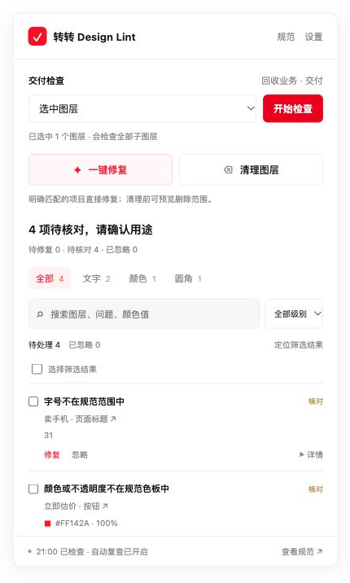

# 转转 Design Lint 2.2 · 轻量版

基于 Daniel Destefanis 的开源 [Design Lint](https://github.com/destefanis/design-lint) 做的转转定制版。沿用交付前检查、图层定位、复查、忽略和样式关联的工作流，重构规则、控制器与中文界面，适配 Figma 动态页面 API。保留原项目 MIT License 和 README.upstream.md。



## 安装到 Figma

1. 解压「转转-Design-Lint-2.2-安装包.zip」到固定位置。
2. 打开 Figma 桌面端中的设计文件。
3. 菜单 **Plugins → Development → Import plugin from manifest…**，选择解压目录里的 `manifest.json`。
4. 在 **Plugins → Development** 中运行「转转 Design Lint · 交付检查」。

安装包已包含 `dist/code.js` 和 `dist/ui.html`，无需安装 Node 或构建。

在 GitHub 中可从仓库的 Releases 页面下载安装包，也可以直接下载整个仓库并导入根目录的 `manifest.json`。

本定制版没有沿用上游社区插件的 ID。若 Figma 当前版本要求 manifest 提供 ID：通过 **Plugins → Development → New plugin** 创建自己的插件，将 Figma 生成的 `id` 加入此 manifest，再导入。发布到团队时也使用 Figma 分配给你的 ID。

## 交付前使用

选中要交付的画板，打开插件，选择「选中的画板 / 图层」，点击「开始检查」。也可以检查当前整个页面。

- **待修复**：文字区间没有文字样式；可见颜色填充或描边没有颜色样式 / 颜色变量。
- **待核对**：颜色或不透明度、字体、字号、价格字形、圆角与内部规范快照不同；明显的语义颜色用途提醒。
- 点击图层名或「定位图层」会在 Figma 中选中图层并缩放定位。「定位筛选结果」一次最多选中 500 个图层。
- 可以按文字、颜色、圆角、级别筛选，并搜索图层名、路径、问题或数值。
- 修改设计稿后自动复查原检查范围。定位其他图层不会悄悄改变复查范围；再次点击「开始检查」会使用当前选择。
- 特殊业务设计可填写原因后忽略。已忽略项保留在报告中，可恢复；实际值改变后会重新报告问题。忽略记录保存在当前页面的插件数据中。
- JSON / CSV 报告包含范围、规则设置、检查时间、跳过信息、问题与忽略原因。浏览器演示中的示例数据不是实际设计稿检查结果。

## 一键修复与指定目标修复

检查后点击「一键修复」，直接应用唯一匹配的同值文字样式、颜色样式 / 变量，以及唯一可用的 Akrobat ExtraBold 价格字形。每次最多应用 100 项，候选查找最多处理前 500 个基础关联 / 价格问题；超出后可再次点击处理。

字号、圆角、多个同值候选和颜色语义需要由设计师选择。点击问题右侧「修复」选择目标，或勾选问题后点「修复所选」，预览并应用。最接近的字号 / 圆角只是参考值。颜色可以绑定真实本地 / 已启用团队变量；没有变量时可应用规范色值，这会解除原关联，缺少颜色关联的问题仍保留。

修改前校验当前值、文本区间、锁定状态、页面、布局与预览是否一致。加载字体 / 变量后再次核对，冲突选项不合并执行；失败的单项尝试恢复属性。修改后自动复查，JSON / CSV 报告包含本次会话修复记录。可通过 Figma 撤销恢复本批修改。

## 清理图层

点击「清理图层」，按当前范围查找 **空文字、空分组、隐藏图层**。空文字仅指字符数为 0，空格文字保留；空分组必须没有子图层和效果；可见空画板不作为垃圾。隐藏父图层列为一个条目，注明所含子图层数量，父子重复选择不会重复列出。

先预览并勾选，再点击「删除 N 个图层」。每次最多列出 500 个删除入口。保留锁定图层及其内容、组件 / 组件集 / 实例和内部内容、由变量或组件属性控制可见性的节点、原型动作和原型目标。为识别跨页原型引用，清理时会使用 Figma API 加载文件页面；只删除所选范围。隐藏父层含受保护内容时保留父层。

删除前再次核对原内容和引用。内容、位置、锁定状态或原型引用变化后跳过；不会仅因之前处于隐藏状态而继续删除。删除包含所列条目的全部子图层，可用 Figma 撤销恢复。结果显示已删除入口数量，子图层数量在预览中单独显示。

## 样式和变量关联

单项「修复」中的关联候选提供本文件中的同值文字样式、同值颜色样式、当前可解析的同值颜色变量。文字样式同时匹配字体、字号、行高、字距、大小写、装饰及段落间距等属性。

已启用的 **ZHUAN / Color** 团队变量也可以成为候选：先按内部规范快照显示名称和颜色；只有你选择「应用修复」时才通过 Figma API 导入，并再次验证当前模式值。实际值不一致时不修改图层。相同颜色存在多个语义时由设计师选择。插件不自动创建同名假变量，也不会开启尚未启用的团队库。

已关联的其他团队库样式或变量可满足基础关联检查。当前实现不按样式 ID 限制必须来自某个团队库；已知 ZHUAN 集合按名称识别，规范没有提供唯一的发布 key 清单。需要严格限定库身份时，应补充真实 collection / variable keys 后扩展规则。

## 已整合的内部规范

来源：[ZHUAN-Design-团队样式规范](https://zhuanspirit.feishu.cn/wiki/E3cHw2PV0iEMR4kCdOTcYLPqn5e)，快照日期 **2026-10-13**。规则配置集中在 `src/shared/spec.ts`，日后规范更新需修改此文件并重新构建；插件不会自动登录飞书或同步文档。

| 规则 | 规范数值与处理 |
| --- | --- |
| 颜色 | 16 个基础色、19 个 Light 语义色；品牌红 `#FF0F27`；蒙层 `#111111 / 70%` |
| 中文 | PingFang SC；字号 20、22、24、26、28、30、32、34、36、40 |
| 价格 | Akrobat ExtraBold；字号 32、40、44、68、72 |
| 基础字号 | 20、22、24、26、28、30、32、34、36、40、44、68、72 |
| 圆角 | 4、8、12、16、24、32、999；额外允许直角 0 |
| 数值标尺 | 默认使用 Figma 原始值；设置中可手动切换原始值 × 0.5，仅影响字号与圆角 |

规范是已发布变量汇总，并非完整组件库规则。正文统一字重、行高、字距、段落间距、间距、描边宽度、组件用途及状态、图标、暗色模式等没有完整定义，留给人工验收。价格判断根据实际字体 Akrobat，中文判断根据文字区间含汉字；特殊标题、拉丁文本或业务字体应由设计师确认用途。

逐区间检查混合文字，逐层检查多重填充与描边，逐个检查四个圆角。图片、视频、不可见填充、透明填充不要求颜色样式；未绑定的渐变需要颜色样式。默认跳过隐藏和锁定子树，包含矢量图标，可以在设置中调整。跳过计数统计跳过的子树入口或矢量节点，不是所有被跳过的后代数。

## 开发和验证

```sh
pnpm install
pnpm check
```

使用 Node 20+ 和 pnpm 11+。`pnpm build` 生成两个独立的 Figma 可加载文件，不依赖外部 CDN；manifest 禁止 UI 直接联网。规范链接通过用户点击在外部浏览器打开，团队库访问使用 Figma 自身 API。

构建采用 esbuild，运行代码与界面均为 TypeScript，界面不需要 React。测试覆盖混合文字、部分绑定、多层填充、透明度、四角、同值候选、团队变量导入前后验证、范围稳定、自动复查、忽略恢复、读取失败和 CSV 公式字符转义。

此版本已通过类型检查、40 项自动化测试、构建与浏览器模拟交互验证；尚未在真实 Figma 文件中完成运行验收。请按 `验收清单.md` 做首次试运行。
